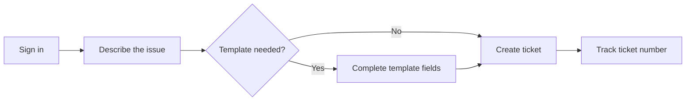
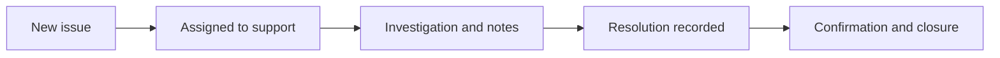

# Getting Started with SERV-IT

SERV-IT is your organization's service desk. Use it to report an issue, track the work, and find answers. The organization name and logo may be customized, while the ticket workflow remains the same.

## Find the Right Page

| Page | What you use it for | Example |
| --- | --- | --- |
| Create Ticket | Report a new issue or request | Inventory application is unavailable |
| My Tickets | Find tickets available to you and follow progress | Check whether your incident is assigned |
| My Query | Search and filter tickets you can access | Find high-priority incidents |
| Knowledge Base | Read guides and troubleshooting articles | Learn how to choose a template |
| Reports | Review permitted service information | Look at your team's ticket totals |
| Configuration | Set up fields, templates, branding and roles, if permitted | Add a customer-specific template |

Your role controls which pages and actions appear. A missing menu item may mean your account does not have that permission.

## Your First Ticket: Alice's Example

Alice works in L1 Support. Five colleagues cannot sign in to the inventory application.

| Field | Example entry | Why it helps |
| --- | --- | --- |
| Customer | Your actual customer or organization | Identifies who needs help |
| Module | Inventory application | Identifies the affected service |
| Category and subcategory | Choose the closest configured options | Routes the issue appropriately |
| Short Description | Five users cannot sign in to inventory | Summarizes the problem |
| Full Description | Since 09:00, five users receive Authentication timeout; two browsers tested | Gives the team useful evidence |
| Priority | Choose from the configured list based on business impact | Helps the team triage |
| Templates | Optional: choose the relevant customer template | Collects extra information |

These are examples, not values automatically created in your configuration. Include the actual date and time zone when reporting a start time.

## Create and Follow a Ticket

1. Sign in with your username and password, or the configured company sign-in option.
2. Complete MFA when your account requires it.
3. Open **Create Ticket** and fill in the required fields marked with an asterisk.
4. Choose a template if relevant. Its fields appear after the descriptions.
5. Add permitted notes or attachments, then select **Create Ticket**.
6. Keep the generated ticket number and open the ticket to follow updates.

## How the Ticket Moves Through Support

The following is an example support journey. Available statuses and transitions depend on configuration and permissions.

| Person | Typical responsibility | What still controls access |
| --- | --- | --- |
| Employee | Create and work on permitted tickets | Employee role permissions and record scope |
| Manager | Supervise tickets for selected teams | Manager role plus Managed Groups |
| Administrator | Configure the service desk | Protected Admin role or delegated permissions |

If you can read a ticket but cannot change it, viewing and editing may have different scopes. Ask an authorized administrator to review your role and groups when access is denied.

## Before You Submit

- [ ] The short description identifies the service and issue.
- [ ] The full description includes timing, impact and exact error.
- [ ] Required normal and template fields are complete.
- [ ] Attachments contain relevant evidence without passwords or secrets.
