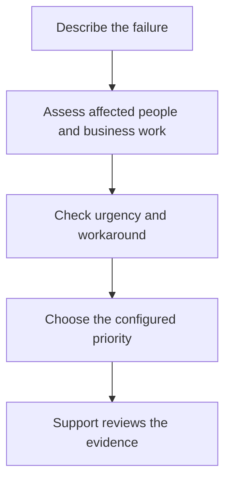
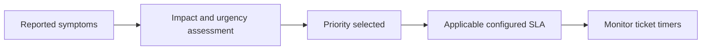

# Choosing a Ticket Priority

Priority communicates how urgently the support team should address an issue. Explain the business impact first, then choose the best matching configured priority. Selecting the highest priority does not replace providing evidence.

## Compare the Common Priority Levels

| Priority | Typical situation | Example | Useful evidence |
| --- | --- | --- | --- |
| Critical | A business-critical service is unavailable with no usable workaround | Production order processing is stopped across the organization | Start time, affected services, users and stopped business process |
| High | A major service is seriously impaired | A department cannot submit orders; a limited workaround exists | Department affected, workaround limits and deadline |
| Medium | Some work is disrupted but operations can continue | A subset of users has intermittent errors | Frequency, affected users and checks already completed |
| Low | Minor inconvenience or non-urgent request | A cosmetic issue or planned information request | Expected result and requested timescale |

Administrators can configure priority choices. These examples explain common levels; use your organization's actual list and incident policy.

## Impact, Urgency and Priority

| Setting | Question it answers | Example |
| --- | --- | --- |
| Impact | How much of the business is affected? | One user, one department, or the organization |
| Urgency | How soon does the issue need attention? | A deadline is approaching and no workaround exists |
| Priority | What triage level should the team use? | High based on documented impact and urgency |

Do not assume changing Impact or Urgency automatically recalculates Priority. Review the selected values before saving.

## Worked Example: Inventory Sign-In Failure

| Scenario | Suggested starting point | Reason |
| --- | --- | --- |
| Alice alone cannot sign in; another browser works | Medium or Low, depending on impact | A usable workaround exists |
| Five warehouse users cannot sign in during dispatch | High, subject to local policy | A team workflow is impaired |
| All sites cannot dispatch orders; no workaround exists | Critical, subject to local policy | A business-critical process has stopped |

These are illustrative assessments. An authorized support lead may change priority after investigation.

## SLA Targets Are Configured Separately

There is no universal four-hour, eight-hour or other fixed target in this article. Check the ticket's SLA information and your organization's configured SLA definitions for the actual target and timer behavior.

## When to Reassess

- The number of affected users increases.
- A critical deadline becomes imminent.
- A previously available workaround stops working.
- Service is restored but follow-up work remains.

Record what changed in a note. Ask someone with **Change priority** permission to update the ticket if you cannot do so yourself.
