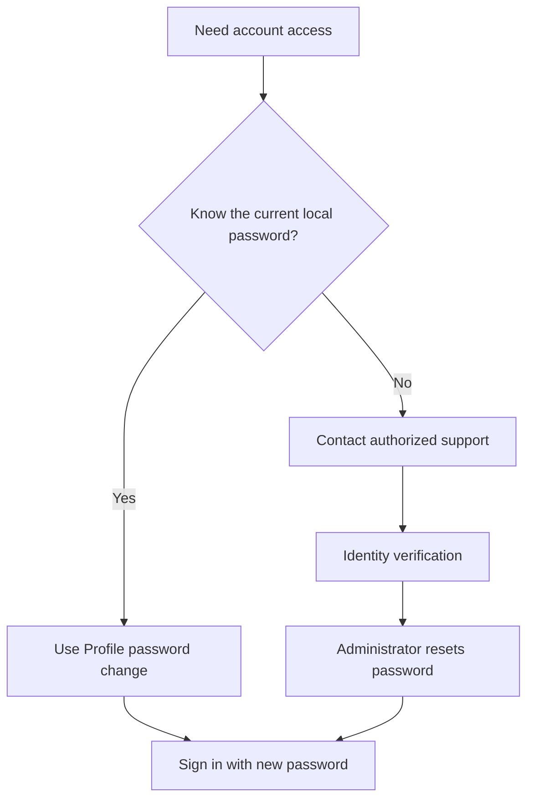
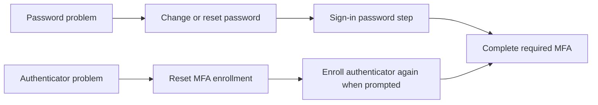

# Changing or Resetting Your Password

Changing a password you still know is different from asking an administrator to reset a forgotten password. MFA enrollment is a separate account setting.

## Choose the Correct Route

| Situation | Who acts? | What to do |
| --- | --- | --- |
| You know your current local password | You, if your role allows it | Open Profile and use the password-change form |
| You forgot your local password | Administrator with Reset passwords permission | Ask support to verify your identity and reset the account password |
| Company SSO password is forgotten | Your company's identity support team | Follow the company identity-provider recovery process |
| Your MFA authenticator is unavailable | Administrator with Reset MFA permission | Request an enrollment reset after identity verification |

Resetting an application password does not reset the company SSO password or automatically reset MFA.

## Change a Password You Know

1. Open **Profile** from your account menu.
2. Enter your current password.
3. Enter and confirm a new password.
4. Save the change and use the new password at your next local sign-in.

| Item | Requirement or guidance |
| --- | --- |
| Length | The server accepts 8 to 256 characters |
| Current password | Required when changing your own password |
| New password | Use a strong, unique password or passphrase |
| Sharing | Do not put passwords in tickets, articles, screenshots or chat messages |

## Administrator Reset Example

Alice has forgotten her local SERV-IT password. An authorized administrator verifies the request, opens **Users > View / Edit > Security**, enters a new password and selects **Reset Password**.

| Person | Responsibility | Example |
| --- | --- | --- |
| Alice | Request help without disclosing an old password | I cannot sign in to my Alice account |
| Administrator | Verify identity and use the permitted reset action | Reset Alice's local account password |
| Alice | Receive the credential through an approved private channel | Sign in and change it to a personal password |

Do not assume the application forces an immediate password change after an administrator reset. The user should change the supplied password promptly when permitted.

## Password and MFA Are Separate

| Message or symptom | Meaning | Next step |
| --- | --- | --- |
| Current password is incorrect | Existing credential did not match | Recheck it or request a reset |
| New password rejected | A validation rule failed | Use 8 to 256 characters and read the displayed message |
| Reset button unavailable | Your role lacks that security action | Ask an authorized administrator |
| Password works but MFA fails | The second authentication step needs attention | Follow MFA support rather than repeatedly resetting the password |
