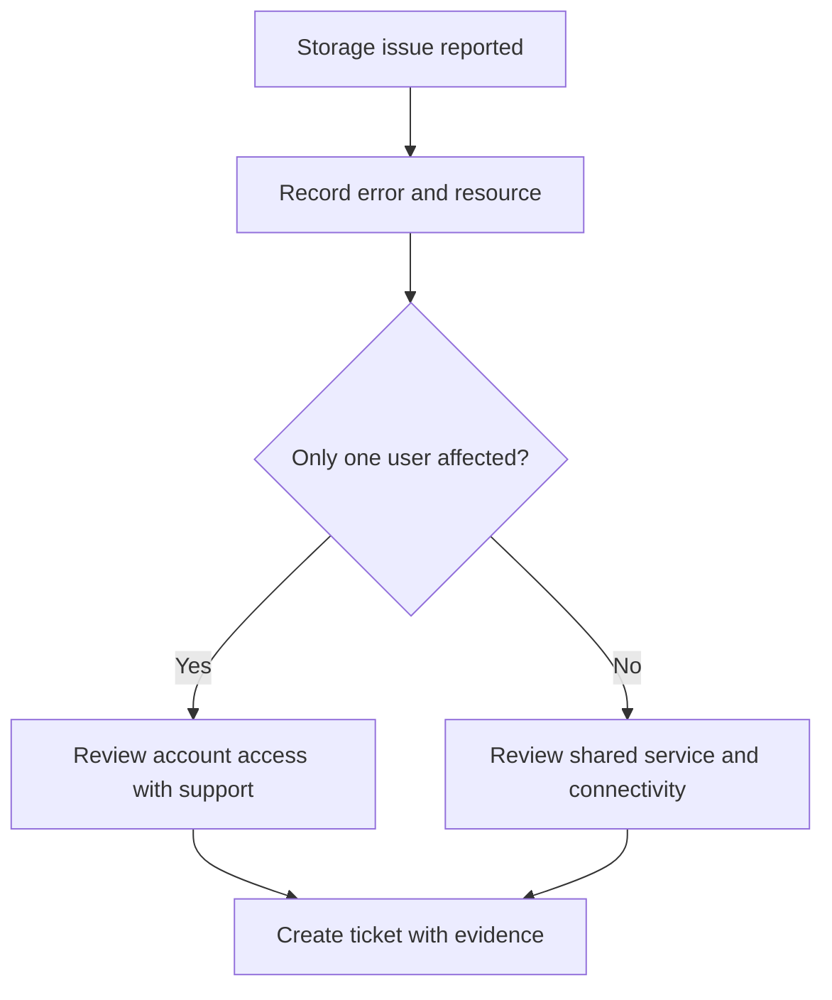
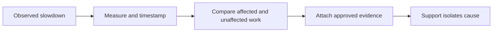

# Common Storage Issues: Check, Record and Escalate

Use this guide to collect useful evidence before raising a storage-related ticket. SERV-IT tracks the issue; it is not a storage-array monitoring console. Use your organization's approved monitoring tools for array metrics.

## Identify the Symptom

| Symptom | Possible investigation area | Safe first check | Evidence to record |
| --- | --- | --- | --- |
| Cannot access a shared volume | Network path, authorization or availability | Confirm the path and whether colleagues are affected | Error text, path, start time and users |
| Reads or writes are slow | Workload, network, host or storage performance | Compare normal behavior with approved monitoring | Duration, transfer size, application and metrics |
| Capacity warning | Growth, quota or retention | Read the alert and confirm the affected volume | Used space, available space, threshold and trend |
| Intermittent disconnects | Network or host connectivity | Note frequency and other affected services | Timestamps, connection type and approved logs |

These are investigation directions, not a diagnosis. Follow operating procedures for service restarts, configuration changes and data operations.

## Example: Alice Cannot Open the Shared Volume

| Observation | Alice's example |
| --- | --- |
| Resource | Warehouse shared volume |
| Symptom | Access denied when opening the dispatch folder |
| Started | 09:10 local time; record the actual date and time zone |
| Scope | Alice and two colleagues; other folders still work |
| Checks completed | Confirmed the path and compared with an unaffected colleague |
| Business impact | Dispatch documents are delayed |

## Slow Performance: Build a Useful Comparison

| Question | Useful answer | Unhelpful answer |
| --- | --- | --- |
| What is slow? | Saving a 200 MB export to the finance share | Everything is slow |
| Compared with what? | Usually 20 seconds; today about 3 minutes | Slower than before |
| Who is affected? | Three finance workstations | Some people |
| When does it happen? | During the morning export window | Randomly |

Record observations rather than changing multiple settings at once. Ask the responsible team to review host, network and storage metrics together.

## Capacity Warnings and Escalation

| Situation | Recommended next action |
| --- | --- |
| Files may be obsolete | Ask the data owner to review retention and archiving requirements |
| Capacity is legitimately required | Request capacity review or expansion |
| Service is unavailable | Describe the business outage and use the priority process |
| Cause is unclear | Raise a ticket with the alert, resource and impact |

Do not delete production files, remove backups or restart shared services just to test this guide. A warning is not automatically Critical: choose priority from impact, urgency and organizational policy.

## Evidence Checklist

- [ ] Exact affected resource and error.
- [ ] Start time, time zone and recurrence.
- [ ] Affected users, applications and business work.
- [ ] Safe checks already completed.
- [ ] Relevant logs or screenshots without secrets.
