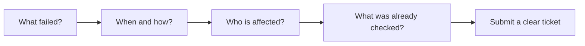
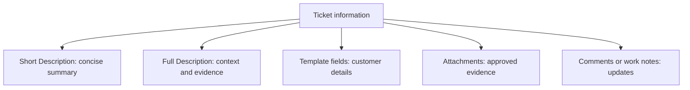

# Writing a Ticket That Support Can Act On

A useful ticket tells the team what failed, how to recognize it and why it matters. Put the summary in **Short Description**, context in **Full Description**, and additional customer information in the selected template fields.

## Build the Description

| Information | Question to answer | Example |
| --- | --- | --- |
| Service | What system is affected? | Inventory application |
| Symptom | What happens instead of the expected result? | Sign-in returns Authentication timeout |
| Timing | When did it start and how often? | Started at 09:00; every sign-in attempt |
| Impact | Who and what work are affected? | Five warehouse users cannot prepare dispatches |
| Reproduction | How can support recognize it? | Open the app, enter valid credentials and select Sign in |
| Checks | What have you already tried? | Two approved browsers show the same result |
| Changes | What changed recently, if known? | No known change reported by the users |

Include the actual date and time zone when recording an incident time.

## Before and After

| Field | Too vague | Better example |
| --- | --- | --- |
| Short Description | App broken | Five warehouse users cannot sign in to inventory |
| Full Description | It does not work. Please fix. | Since 09:00, five users receive Authentication timeout. Two browsers show the same result. Dispatch preparation is delayed. |
| Priority explanation | Urgent | The team cannot prepare dispatches and no approved workaround exists |

## A Completed Example

**Short Description:** Five warehouse users cannot sign in to inventory.

**Full Description:** At 09:00 on the actual incident date, warehouse users began receiving Authentication timeout after selecting Sign in. Five users are affected. The behavior repeats in two approved browsers. Dispatch preparation is delayed. No recent device change has been reported. A screenshot is attached and contains no password or access token.

| Optional template field | Example value |
| --- | --- |
| Affected Users | 5 |
| Environment | Production |
| Investigation Notes | Compared two browsers; recorded error and start time |
| Customer Approval Received | Off, if approval has not been received |

These fields must first exist in the selected template.

## Put Information in the Right Place

| Problem | Why it slows the team | Better approach |
| --- | --- | --- |
| Unrelated issues in one ticket | Different teams may need different investigations | Create separate tickets for independent issues |
| Missing error message | Support cannot identify the failure | Copy the exact error text |
| Highest priority without impact evidence | Triage lacks context | Explain affected work and workaround availability |
| Secrets in screenshots | Readers may gain information they should not have | Remove secrets before attaching evidence |
| Repeating the description for every update | Progress becomes hard to find | Add a note describing what changed |

Before saving, complete the configured required fields and required template fields. A template is optional; the normal descriptions remain part of the ticket.
