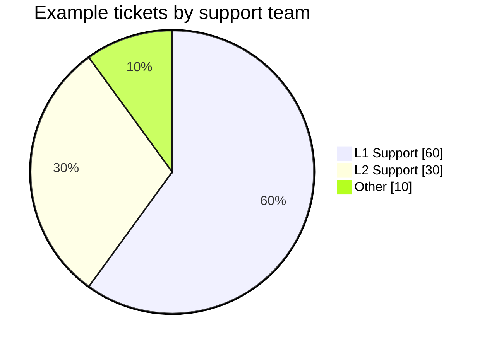
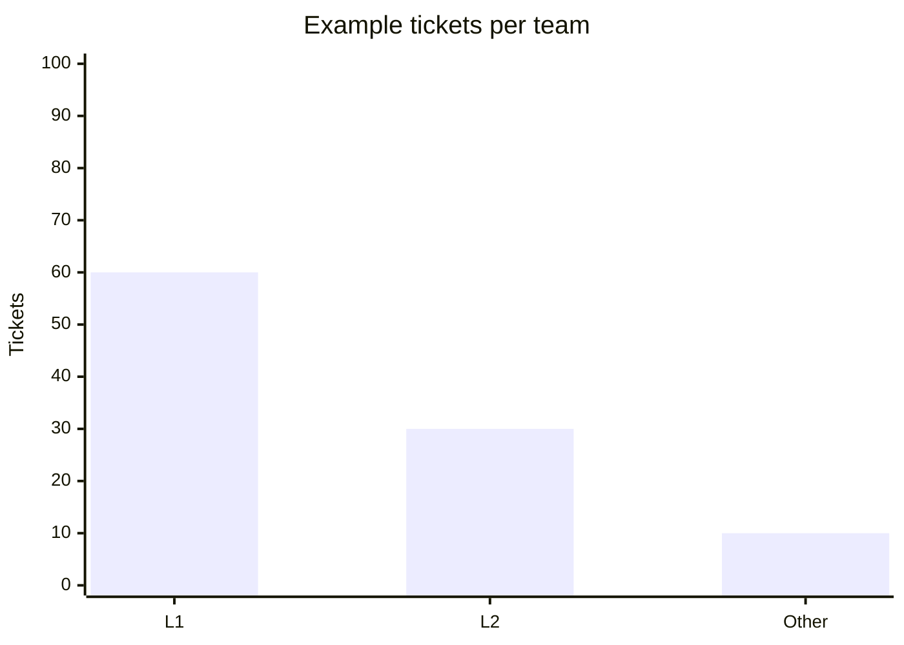
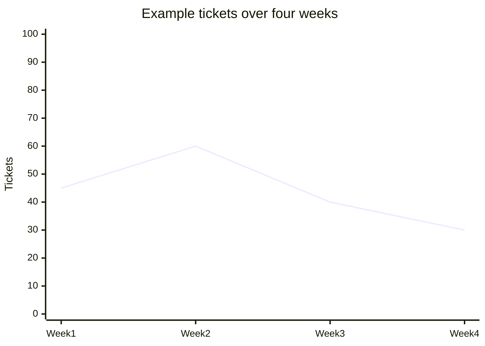
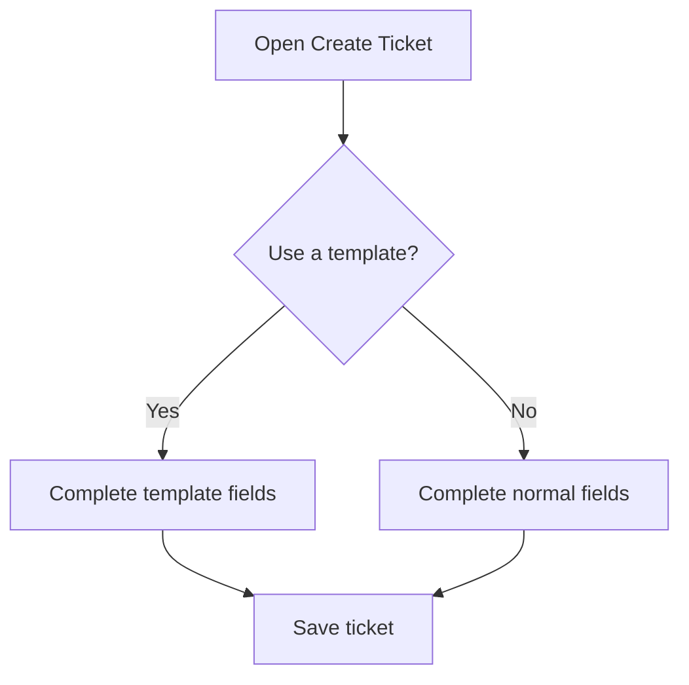
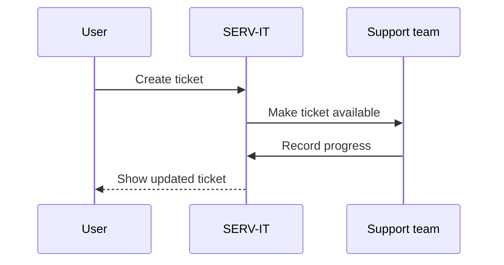
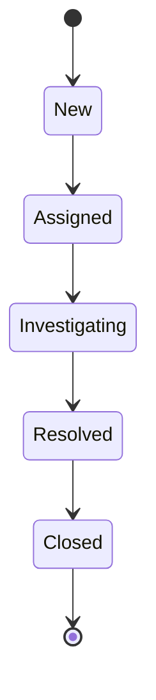
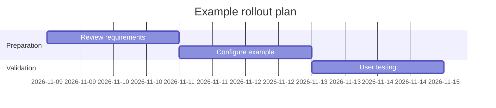
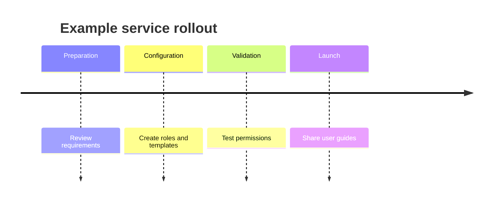
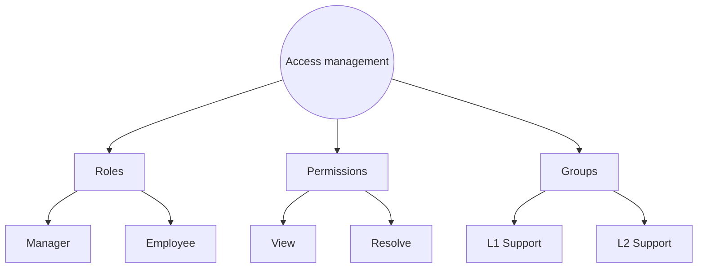
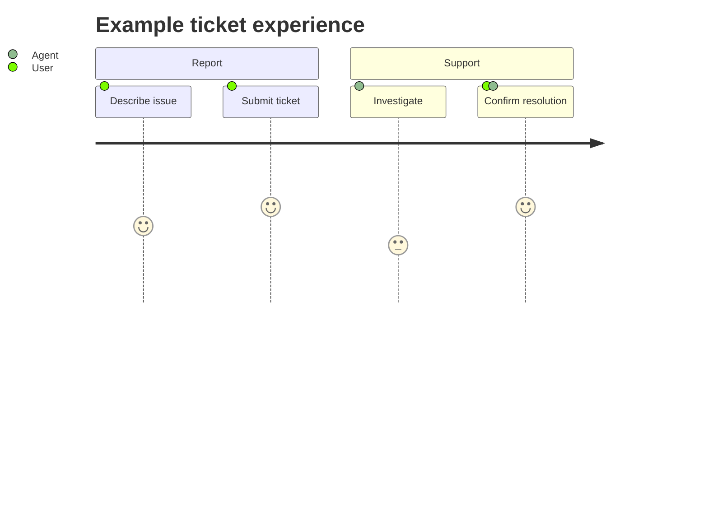

# Create Knowledge Base Articles with Markdown: Syntax and Output

This is a copy-and-edit reference. Each example shows **Syntax first** and its **Output immediately below**. Select **Copy code** on a syntax block, paste it into your article's Markdown source, and replace the example words or numbers.

## Create Your Article

1. Open **Knowledge Base > New Article**.
2. Enter the title and choose a category.
3. Paste Markdown into **Markdown source**.
4. Choose **Side by side** to see source and output together, or **Preview** to read the result.
5. Choose Draft or Published and save the article. Creating, editing, publishing and reading drafts depend on your permissions.

| Editor option | Purpose |
| --- | --- |
| Write Markdown | Edit the source text |
| Side by side | Compare syntax with formatted output |
| Preview | Review the article body before saving |

The preview and saved article use the same renderer. You do not need to write application code to use these styles.

## What You Can Copy from This Guide

| Part | Examples |
| --- | --- |
| Text and structure | Six heading levels, paragraphs, line breaks, emphasis, lists, tasks, quotes and separators |
| References and media | Links, automatic links, reference links, images, linked images and footnotes |
| Data and technical content | Tables, aligned columns, inline code, highlighted code and math |
| Charts and diagrams | Pie, bar, line, flowchart, sequence, state, Gantt, timeline, mind map and advanced examples |

Use your browser's Find command to locate a style by name. All people, counts, dates and diagrams below are illustrative, not live application data.

## How to Copy a Chart Correctly

Copy the **entire syntax block**, including its opening three backticks, the word **mermaid**, and the closing three backticks. The four backticks around the displayed syntax are only the guide's way of showing that example; Copy code copies the example inside them.

Keep indentation in Mermaid examples. Replace labels and numbers while preserving the structural lines.

# Part A: Text, Lists and Tables
## 1. Headings - six levels

Add a space after the # symbols. Use headings to divide an article into readable sections.

### Syntax - copy this

````markdown
# Main heading
## Section heading
### Subsection
#### Detail heading
##### Smaller heading
###### Smallest heading
````

### Output

# Main heading
## Section heading
### Subsection
#### Detail heading
##### Smaller heading
###### Smallest heading


## 2. Paragraphs and explicit line breaks

A blank line starts a paragraph. Two spaces at the end of a line create a deliberate line break; the Customer line below ends with two spaces.

### Syntax - copy this

````markdown
This is the first paragraph.

This is a separate paragraph.

Customer: Example Company  
Environment: Production
````

### Output

This is the first paragraph.

This is a separate paragraph.

Customer: Example Company  
Environment: Production


## 3. Bold, italic, combined emphasis and strikethrough

Use emphasis to highlight meaning. Strikethrough can show a replaced value or outdated step.

### Syntax - copy this

````markdown
**Important** information.

*Optional* details.

***Very important*** information.

~~Old procedure~~ Use the current procedure.
````

### Output

**Important** information.

*Optional* details.

***Very important*** information.

~~Old procedure~~ Use the current procedure.


## 4. Inline code

Use single backticks for short field names, values, commands or identifiers.

### Syntax - copy this

````markdown
Choose `Selected Groups` and enter `L1 Support`.
````

### Output

Choose `Selected Groups` and enter `L1 Support`.


## 5. Bullets and nested lists

Start bullet items with a dash and space. Indent child items beneath their parent.

### Syntax - copy this

````markdown
- Support teams
  - L1 Support
  - L2 Support
- Application administrators
````

### Output

- Support teams
  - L1 Support
  - L2 Support
- Application administrators


## 6. Numbered steps and nested instructions

Use numbered lists when order matters. Indent nested numbered steps.

### Syntax - copy this

````markdown
1. Open Configuration.
2. Choose Roles.
   1. Enter the role name.
   2. Select permissions.
3. Review and save.
````

### Output

1. Open Configuration.
2. Choose Roles.
   1. Enter the role name.
   2. Select permissions.
3. Review and save.


## 7. Task checklists

Use x for complete and a space for incomplete. These are read-only indicators in an article; change their Markdown to update them.

### Syntax - copy this

````markdown
- [x] Role name entered
- [x] Permissions reviewed
- [ ] Managed Groups assigned
````

### Output

- [x] Role name entered
- [x] Permissions reviewed
- [ ] Managed Groups assigned


## 8. Quotes and notes

Start quoted lines with >. Bold text inside a quote is useful for a clear note.

### Syntax - copy this

````markdown
> **Remember:** Managed Groups does not enable an unchecked permission.
>
> Check the role and the record scope together.
````

### Output

> **Remember:** Managed Groups does not enable an unchecked permission.
>
> Check the role and the record scope together.


## 9. Section separators

Place three dashes on their own line, with blank lines around them, to separate topics.

### Syntax - copy this

````markdown
First topic.

---

Next topic.
````

### Output

First topic.

---

Next topic.


## 10. Comparison tables

Keep the header row, separator row and data rows. Add another row to add another comparison.

### Syntax - copy this

````markdown
| Setting | Alice | David |
| --- | --- | --- |
| Role | User / Employee | Manager |
| Groups | L1 Support | L1 Support |
| Managed Groups | None | L1 and L2 Support |
````

### Output

| Setting | Alice | David |
| --- | --- | --- |
| Role | User / Employee | Manager |
| Groups | L1 Support | L1 Support |
| Managed Groups | None | L1 and L2 Support |


## 11. Table alignment and a literal pipe character

A colon on the left means left aligned, colons on both sides mean centered, and a colon on the right means right aligned. Escape a literal pipe with a backslash. Wide tables scroll horizontally when needed.

### Syntax - copy this

````markdown
| Description | Status | Count |
| :--- | :---: | ---: |
| L1 Support | Active | 25 |
| L2 Support | Active | 15 |
| Read \| Write access | Review | 2 |
````

### Output

| Description | Status | Count |
| :--- | :---: | ---: |
| L1 Support | Active | 25 |
| L2 Support | Active | 15 |
| Read \| Write access | Review | 2 |


## 12. Escaping Markdown symbols

Put a backslash before a formatting character when you want to show the character itself.

### Syntax - copy this

````markdown
\*This is literal text, not italic.\*

\# This is not a heading.

The path label uses an underscore: customer\_name.
````

### Output

\*This is literal text, not italic.\*

\# This is not a heading.

The path label uses an underscore: customer\_name.


# Part B: Links, Images, Code and Math


## 13. Named links and automatic links

Use a named link for readable instructions. Ordinary web addresses can also become links. Links open in a separate tab.

### Syntax - copy this

````markdown
[Open the Roles article](/knowledge-base/9)

https://example.com
````

### Output

[Open the Roles article](/knowledge-base/9)

https://example.com


## 14. Reference-style links

Keep a reusable destination at the bottom of the source section, then reference it by name.

### Syntax - copy this

````markdown
Read the [Roles guide][roles-guide] before assigning access.

[roles-guide]: /knowledge-base/9
````

### Output

Read the [Roles guide][roles-guide] before assigning access.

[roles-guide]: /knowledge-base/9


## 15. Images with alternative text

Replace /psh.png with a reachable image URL. Alternative text describes the image. Plain-text copying does not upload an image file.

### Syntax - copy this

````markdown

````

### Output


## 16. Clickable images

Wrap an image in a link to make the image clickable. Replace both the image address and destination as needed.

### Syntax - copy this

````markdown
[](/knowledge-base/9)
````

### Output

[](/knowledge-base/9)


## 17. Highlighted code blocks

Use three backticks and a language label. Common labels include javascript, python, json, sql, bash, html and css. Code is displayed, not executed. The output has its own Copy code button.

### Syntax - copy this

````markdown
```javascript
const role = "Manager";
console.log(role);
```
````

### Output

```javascript
const role = "Manager";
console.log(role);
```


## 18. Plain text blocks

Use text when no programming-language highlighting is needed. Spacing and line breaks stay intact.

### Syntax - copy this

````markdown
```text
Customer: Example Company
Affected users: 25
Environment: Production
```
````

### Output

```text
Customer: Example Company
Affected users: 25
Environment: Production
```


## 19. Inline mathematics

Put a short expression between single dollar signs. Replace 8 and 10 with your example values.

### Syntax - copy this

````markdown
Resolution rate = $\frac{8}{10} \times 100 = 80\%$.
````

### Output

Resolution rate = $\frac{8}{10} \times 100 = 80\%$.


## 20. Display mathematics

Put a longer expression between double dollar signs on separate lines.

### Syntax - copy this

````markdown
$$
\text{Resolution rate} = \frac{\text{Resolved tickets}}{\text{Total tickets}} \times 100
$$
````

### Output

$$
\text{Resolution rate} = \frac{\text{Resolved tickets}}{\text{Total tickets}} \times 100
$$


## 21. Footnotes

Footnotes keep extra explanation out of the main sentence. The rendered note appears at the end of the article, with a return link.

### Syntax - copy this

````markdown
The target depends on the configured SLA.[^sla-example]

[^sla-example]: This is an explanatory footnote, not a fixed service commitment.
````

### Output

The target depends on the configured SLA.[^sla-example]

[^sla-example]: This is an explanatory footnote, not a fixed service commitment.


# Part C: Charts and Process Diagrams

Every example below is a Mermaid code block. The syntax creates a static explanatory visual. It does not read your live tickets or change application settings.

| Choose this visual | When it helps |
| --- | --- |
| Pie chart | Show parts of one total |
| Bar or line chart | Compare counts or a trend |
| Flowchart | Explain steps and decisions |
| Sequence diagram | Show who communicates with whom |
| State diagram | Explain example lifecycle transitions |
| Gantt or timeline | Explain planned work or milestones |
| Mind map or block diagram | Organize concepts or components |
| Class, ER or C4 diagram | Explain technical relationships |


## 22. Pie chart - ticket distribution

Change the title, quoted labels and numbers. Values are parts of a total; they do not need to add up to 100. Percentages are calculated from the sum.

### Syntax - copy this

````markdown

````

### Output


## 23. Bar chart - compare ticket counts

Change the category labels and bar values together. Keep one value per category and use an axis range that covers your values.

### Syntax - copy this

````markdown

````

### Output


## 24. Line chart - show a trend

Replace the week labels and values. A line chart is useful for a trend rather than a share of a total.

### Syntax - copy this

````markdown

````

### Output


## 25. Flowchart - steps and decisions

TD means top to bottom; replace it with LR for left to right. Square brackets create a box and braces create a decision. Edit text inside brackets without changing the node identifiers.

### Syntax - copy this

````markdown

````

### Output


## 26. Sequence diagram - user and service interaction

Change participant names and message text. This describes an example interaction, not an automatic notification guarantee.

### Syntax - copy this

````markdown

````

### Output


## 27. State diagram - example lifecycle

Edit state names and arrows. This is a documentation example; actual ticket states and allowed changes follow configuration and permissions.

### Syntax - copy this

````markdown

````

### Output


## 28. Gantt chart - planned work

Change dates, task names and durations. The suffix d means days. Task identifiers connect dependent tasks. These are illustrative planning dates.

### Syntax - copy this

````markdown

````

### Output


## 29. Timeline - milestones

Replace the labels before each colon and the milestone text after it.

### Syntax - copy this

````markdown

````

### Output


## 30. Mind-map-style hierarchy - organize concepts

Use a branching flowchart for a mind-map-style hierarchy with readable SVG labels. Change box text and add arrows for more branches. This example uses flowchart syntax rather than the specialized mindmap renderer.

### Syntax - copy this

````markdown

````

### Output


## 31. User journey - experience steps

Each task includes an example score and participating actors. Change the task labels, scores and actor names. Scores illustrate the experience, not live performance data.

### Syntax - copy this

````markdown

````

### Output


## 32. Entity relationship diagram

Use this to explain conceptual data relationships. Change entity and attribute labels. This example is not the actual database schema.

### Syntax - copy this

````markdown
```mermaid
erDiagram
    USER ||--o{ TICKET : creates
    TEAM ||--o{ TICKET : receives
    USER {
        string name
        string role
    }
    TICKET {
        string number
        string summary
    }
```
````

### Output

```mermaid
erDiagram
    USER ||--o{ TICKET : creates
    TEAM ||--o{ TICKET : receives
    USER {
        string name
        string role
    }
    TICKET {
        string number
        string summary
    }
```


## 33. Class diagram

Explain conceptual objects and their relationships. Replace the class names, properties and relationship labels.

### Syntax - copy this

````markdown
```mermaid
classDiagram
    class User {
        +name
        +role
    }
    class Ticket {
        +number
        +summary
    }
    User "1" --> "many" Ticket : creates
```
````

### Output

```mermaid
classDiagram
    class User {
        +name
        +role
    }
    class Ticket {
        +number
        +summary
    }
    User "1" --> "many" Ticket : creates
```


## 34. Git graph - example change history

Change branch names and commit labels to explain a workflow. Rendering this example does not run Git or create commits.

### Syntax - copy this

````markdown
```mermaid
gitGraph
    commit id: "Start"
    branch feature
    checkout feature
    commit id: "Add guide"
    checkout main
    merge feature
    commit id: "Publish"
```
````

### Output

```mermaid
gitGraph
    commit id: "Start"
    branch feature
    checkout feature
    commit id: "Add guide"
    checkout main
    merge feature
    commit id: "Publish"
```


## 35. Quadrant chart - compare two dimensions

Change axis descriptions and items. Each point has two coordinates between 0 and 1. This is a planning example, not an application access rule.

### Syntax - copy this

````markdown
```mermaid
quadrantChart
    title Example improvement priorities
    x-axis Low effort --> High effort
    y-axis Low benefit --> High benefit
    quadrant-1 Plan carefully
    quadrant-2 Quick wins
    quadrant-3 Low priority
    quadrant-4 Reconsider
    Clearer guide: [0.2, 0.8]
    Large redesign: [0.8, 0.7]
```
````

### Output

```mermaid
quadrantChart
    title Example improvement priorities
    x-axis Low effort --> High effort
    y-axis Low benefit --> High benefit
    quadrant-1 Plan carefully
    quadrant-2 Quick wins
    quadrant-3 Low priority
    quadrant-4 Reconsider
    Clearer guide: [0.2, 0.8]
    Large redesign: [0.8, 0.7]
```


## 36. Requirement diagram

Describe a requirement and the component that satisfies it. Keep the structural keywords and replace the identifiers and descriptions.

### Syntax - copy this

````markdown
```mermaid
requirementDiagram
    requirement ticket_access {
        id: R1
        text: Users access permitted tickets
        risk: medium
        verifymethod: test
    }
    element access_check {
        type: software
    }
    access_check - satisfies -> ticket_access
```
````

### Output

```mermaid
requirementDiagram
    requirement ticket_access {
        id: R1
        text: Users access permitted tickets
        risk: medium
        verifymethod: test
    }
    element access_check {
        type: software
    }
    access_check - satisfies -> ticket_access
```


## 37. Block diagram - component layout

Change box labels and connections. The columns value controls the number of layout columns.

### Syntax - copy this

````markdown
```mermaid
block-beta
    columns 3
    A["User"] B["Service desk"] C["Support team"]
    A --> B
    B --> C
```
````

### Output

```mermaid
block-beta
    columns 3
    A["User"] B["Service desk"] C["Support team"]
    A --> B
    B --> C
```


## 38. Kanban - an example work board

Change column and card labels. This is a static illustration, not a live board or ticket editor.

### Syntax - copy this

````markdown
```mermaid
kanban
    todo[To do]
        a[Review requirements]
    doing[In progress]
        b[Write article]
    done[Done]
        c[Confirm scope]
```
````

### Output

```mermaid
kanban
    todo[To do]
        a[Review requirements]
    doing[In progress]
        b[Write article]
    done[Done]
        c[Confirm scope]
```


## 39. Sankey chart - show quantities moving between stages

Each data line is source,destination,value. Edit names and positive quantities. Keep totals consistent when the example describes the same set of tickets.

### Syntax - copy this

````markdown
```mermaid
sankey-beta
Reported,L1 Support,60
Reported,L2 Support,40
L1 Support,Resolved,45
L1 Support,In progress,15
L2 Support,Resolved,25
L2 Support,In progress,15
```
````

### Output

```mermaid
sankey-beta
Reported,L1 Support,60
Reported,L2 Support,40
L1 Support,Resolved,45
L1 Support,In progress,15
L2 Support,Resolved,25
L2 Support,In progress,15
```


## 40. Packet diagram - field layout

Use this for a technical bit-field layout. Change bit ranges and labels; this is not a ticket form definition.

### Syntax - copy this

````markdown
```mermaid
packet-beta
    0-7: "Type"
    8-15: "Flags"
    16-31: "Length"
```
````

### Output

```mermaid
packet-beta
    0-7: "Type"
    8-15: "Flags"
    16-31: "Length"
```


## 41. C4 context diagram

Describe a system and the people using it. Replace names and descriptions. This is a conceptual overview, not a complete deployment diagram.

### Syntax - copy this

````markdown
```mermaid
C4Context
    title Example service desk context
    Person(employee, "Employee", "Reports an issue")
    System(servit, "SERV-IT", "Tracks support tickets")
    Rel(employee, servit, "Uses")
```
````

### Output

```mermaid
C4Context
    title Example service desk context
    Person(employee, "Employee", "Reports an issue")
    System(servit, "SERV-IT", "Tracks support tickets")
    Rel(employee, servit, "Uses")
```


# Part D: Copying, Publishing and Troubleshooting

## What to Edit and What to Keep

| Example | Edit these values | Keep this structure |
| --- | --- | --- |
| Table | Column names and row values | Header separator row and pipes |
| Pie | Labels, values and title | pie declaration and label/value format |
| Bar or line | Axis labels and numbers | One value per category |
| Flowchart | Box labels and branch labels | Node identifiers, arrows and brackets |
| Timeline or Gantt | Milestones, dates and durations | Diagram declaration and required date format |
| Code | Your sample code | Opening language fence and closing fence |
| Math | Symbols and values | Matching dollar-sign delimiters |

## Common Problems

| What you see | What to check |
| --- | --- |
| Table appears as plain text | Include the separator row immediately below the header |
| Diagram stays as a code sample | Use mermaid as the code-block language |
| Diagram shows a syntax error | Check indentation, quotes, brackets and required keywords |
| Entire article appears as code | Remove an accidental outer fence around the entire pasted article |
| Image is absent | Use a reachable URL; copied text does not include image files |
| Line breaks disappear | Use a blank line for paragraphs or two trailing spaces for a deliberate break |
| A diagram lacks live values | Examples are static; replace the illustrative values yourself |

## Styles That Are Not Enabled

Raw HTML, scripts, embedded iframes, custom CSS and article-level Mermaid configuration directives are not enabled. GitHub-specific alert boxes, automatic heading links and arbitrary ChatGPT interactive widgets are not additional supported features. Use the quote, table, math and chart examples above instead.

This guide demonstrates the editor's text formatting and a broad set of chart styles tested in this application. Mermaid has additional specialized diagram families; use the official syntax reference if you need one, and confirm its output in Preview before publishing. Optional integrations, icons or external assets are not guaranteed merely because they appear in external examples.

## Final Checklist

- [ ] Title and category describe the article.
- [ ] Every table has a separator row.
- [ ] Every code or Mermaid block has matching fences.
- [ ] Example values are clearly labeled and replaced where needed.
- [ ] Images and links point to intended destinations.
- [ ] Preview shows the expected result before saving.

## Further Syntax References

- [Mermaid diagram reference](https://mermaid.js.org/intro/)
- [Mermaid pie chart reference](https://mermaid.js.org/syntax/pie.html)
- [Mermaid XY chart reference](https://mermaid.js.org/syntax/xyChart.html)
- [GitHub-flavored Markdown features](https://github.com/remarkjs/remark-gfm)

The examples in this article use local application rendering. External reference pages may show options that are intentionally restricted here.
