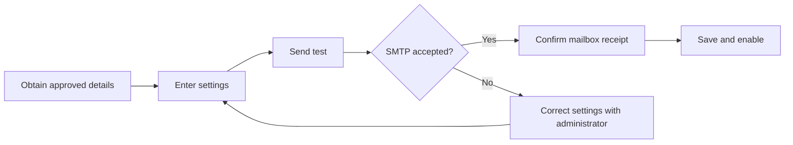
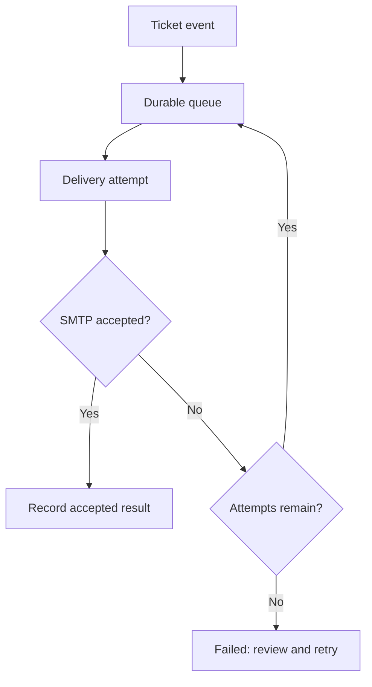

# Email Configuration: Set Up, Test and Track Delivery

Connect SERV-IT to your organization's approved mail service. A successful test means the SMTP server accepted a message; confirm inbox or spam-folder receipt separately.

## Choose an Authentication Method

| Method | When to use it | Necessary details |
| --- | --- | --- |
| SMTP password / app password | A provider-approved SMTP account | Username and password; app passwords work only when permitted |
| OAuth2 with automatic token refresh | Modern provider authentication, including Microsoft 365 or Gmail | Account email, client ID, client secret, refresh token and HTTPS token endpoint |
| No authentication | An approved internal relay | Relay host, port and authorized sender; no account password |

Presets fill connection options. They do not create a mail account, grant provider consent or obtain OAuth tokens.

## Connection and Sender Fields

| Field | Example or source | What to check |
| --- | --- | --- |
| SMTP Host | Approved hostname from your mail administrator | Enter a hostname or IP, without a URL or port |
| Port | Usually 587 for STARTTLS or 465 for SSL/TLS | Use the provider's approved port |
| Encryption | STARTTLS or SSL/TLS | Must match the server |
| From Name | Your organization Support | Friendly display name |
| From Email | Approved notification address | Account must be allowed to send as this address |
| Test recipient | Intended mailbox | Use one valid address |

Unencrypted None mode is only for an approved trusted network. TLS certificate verification is always enabled.

## Microsoft 365 and Gmail OAuth2

| Detail | Microsoft 365 | Gmail / Workspace |
| --- | --- | --- |
| Preset | Microsoft 365 | Gmail / Workspace |
| Typical host | smtp.office365.com | smtp.gmail.com |
| Typical transport | Port 587, STARTTLS | Port 587, STARTTLS |
| Authentication | OAuth2 | OAuth2, or another method explicitly allowed by the organization |
| Token endpoint | Replace YOUR_TENANT_ID in the displayed Microsoft endpoint | https://oauth2.googleapis.com/token |
| Credentials | Client ID, client secret and refresh token from the identity administrator | Client ID, client secret and refresh token from the identity administrator |

The identity administrator must authorize SMTP access and initial consent. This page uses the supplied refresh token; it does not run the initial consent flow. Credentials are encrypted in storage. Rotated refresh tokens are saved securely when testing saved settings or delivering queued mail.

## Setup Example: Organization Support Mailbox

1. Open **Email Config** and choose the appropriate preset.
2. Enter the approved SMTP host, port and encryption.
3. Choose the authentication method and enter its necessary details.
4. Enter From Name and an authorized From Email.
5. Enter an intended test recipient and select **Send Test Email**.
6. Check the result and confirm receipt in the mailbox.
7. Select **Save Configuration**.
8. Turn on Enabled and save when ready to send ticket notifications.

Testing does not save settings or enable notifications. Empty credential fields retain saved credentials; use Remove saved credential to clear one explicitly. Re-enter credentials when changing server or account.

## Advanced TLS Settings

| Option | Purpose | Example |
| --- | --- | --- |
| TLS certificate server name | Verify a named certificate when connecting to an SMTP IP | Certificate hostname from the mail team |
| Trusted CA certificate | Trust an approved private CA without disabling verification | PEM certificate supplied by the administrator |

The configured CA also applies to an OAuth token endpoint. Do not paste a private key. A deployment administrator must keep the persistent EMAIL_ENCRYPTION_KEY secure and backed up; losing it makes saved credentials unreadable.

## Delivery History and Retries

Enabled ticket-event notifications enter a durable database queue. The worker checks every 15 seconds. Failed attempts retry with backoff for up to three attempts.

| History status | Meaning | What to do |
| --- | --- | --- |
| pending | Waiting or scheduled for a retry | Refresh later |
| sending | A worker has claimed the message | Allow the attempt to complete |
| SMTP accepted | Server accepted the message | Check recipient delivery separately |
| failed | Automatic attempts are exhausted | Correct configuration, then use Retry if permitted |

Disabled configuration pauses queued delivery. Manual retry can resend an ambiguously accepted message; review history before retrying.

## Permissions

| Permission | Allows |
| --- | --- |
| View email configuration | Read settings |
| Edit email configuration | Change connection, authentication and sender details |
| Test email configuration | Test saved settings |
| Enable or disable email configuration | Change notification enablement |
| View email delivery history | Read recent delivery metadata |
| Retry failed email deliveries | Queue a failed message for another attempt |

Testing changed settings also requires Edit permission. A test-only user can test saved settings. Viewing does not grant the other actions.

## Common Problems

| Result | What to check |
| --- | --- |
| Authentication failed | Account, provider policy, password or OAuth consent/token details |
| Certificate validation failed | Certificate hostname, expiry and approved CA |
| Connection failed | Host, port, encryption and permitted network access |
| Sender or recipient rejected | Approved sender address and recipient validity |
| Test works but event mail is absent | Save changes, enable notifications and review delivery history |
| Action denied | Assigned email permissions |

Ticket assignment, status/resolution, comments, work notes and SLA events use this configuration. Email content uses organization branding and escapes user-entered text.

## Provider References

- [Microsoft SMTP OAuth setup](https://learn.microsoft.com/en-us/exchange/client-developer/legacy-protocols/how-to-authenticate-an-imap-pop-smtp-application-by-using-oauth)
- [Nodemailer OAuth2 reference](https://nodemailer.com/smtp/oauth2)
