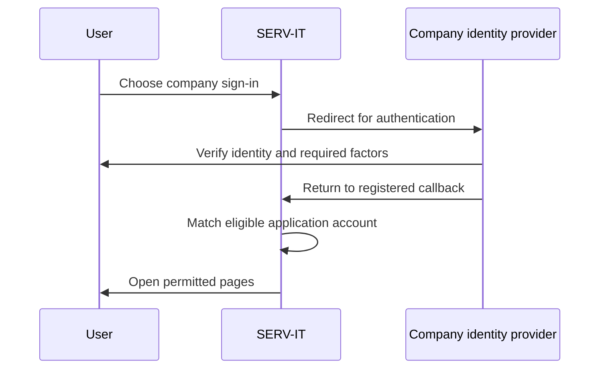
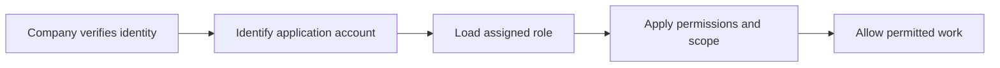

# Company Sign-In with SSO

Single Sign-On lets users authenticate through the organization's identity provider instead of entering a separate local application password. SERV-IT uses OpenID Connect. The company identity team supplies and approves provider settings.

## Understand the Settings

| Setting | Purpose | What to enter |
| --- | --- | --- |
| Provider Display Name | Label for company sign-in | Organization's chosen provider label |
| Issuer URL | Identifies the OpenID Connect provider | Exact issuer from the identity team |
| Client ID | Identifies the registered application | Application identifier from the provider |
| Client Secret | Application credential | Approved secret, handled privately |
| Redirect URI | Destination after authentication | Exact application callback address |
| Auto-provision users | Requests creation of an eligible new user | Must also be enabled in deployed server configuration |
| Enabled | Makes the configured sign-in route available | Enable after the setup is reviewed |

The Redirect URI must match the provider registration and deployed callback configuration. In production, use the approved deployment address, not a copied localhost example.

## Setup Steps

1. Ask the identity administrator to register SERV-IT as an OpenID Connect application.
2. Provide the exact callback address required by the deployment.
3. Obtain the Issuer URL, Client ID and approved credential.
4. Open **SSO** with the necessary permissions.
5. Enter the values and use **Test Connection** for provider discovery.
6. Save the settings and confirm deployed server configuration matches.
7. Perform a real sign-in with an approved test user before rollout.

Test Connection checks provider discovery. It does not complete user sign-in or prove every callback and account-mapping setting is correct.

## Example: Alice Signs In

| Stage | Alice's example | What matters |
| --- | --- | --- |
| Account | Alice has an approved active SERV-IT account | Access exists or eligible provisioning is configured |
| Authentication | Alice chooses company sign-in | Identity provider verifies her |
| Mapping | Her identity matches her application account | Email and identity mapping are correct |
| Authorization | User / Employee permissions load | SSO does not make Alice an Admin |
| Daily use | Alice sees permitted pages and tickets | Role and group rules still apply |

## Authentication and Authorization Differ

| Question | Controlled by |
| --- | --- |
| Is this person who they claim to be? | Identity provider and sign-in process |
| Is the application account active? | SERV-IT user administration |
| Can they read team tickets? | Assigned role and record scope |
| Can they administer configuration? | Application permissions |

## Troubleshooting

| Symptom | First check |
| --- | --- |
| Discovery fails | Exact issuer and connectivity with the identity team |
| Redirect mismatch | Registered URI, saved URI and deployed callback match |
| No eligible application user | Active account, mapping and approved server-side provisioning |
| Company sign-in option missing | Saved enablement and deployed provider settings |
| Sign-in works but a page is denied | Application role and permissions, not the identity password |

Do not put client secrets, tokens or passwords in tickets or articles. Retain an approved administrative recovery route while validating SSO.
