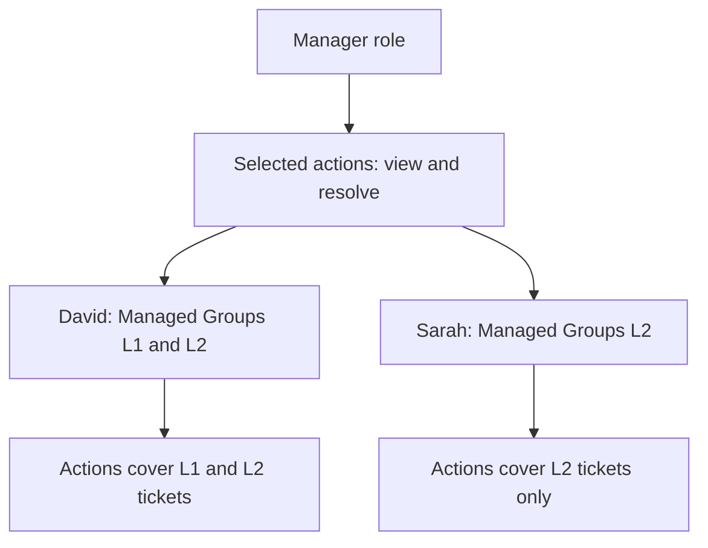

# Understanding Roles, Permissions, Groups and Managed Groups

These four settings work together, but each answers a different question.

| Setting | Simple meaning | Question it answers |
| --- | --- | --- |
| Role | A named set of allowed actions | What responsibility does this person have? |
| Permissions | The individual actions selected for that role | What can this person do? |
| Groups | Teams the user belongs to | Which teams is this person a member of? |
| Managed Groups | Teams covered by the user's Selected Groups permissions | Which teams can this person supervise through those permissions? |

Let's explain each one separately, then put them together using **David, a support manager**. The names and settings below are examples; this article does not create users, teams or roles.

## 1. Roles: What Responsibility Does the Person Have?

A **Role** is a name for a set of permissions. You assign a role to a user so the application knows which actions that person is allowed to perform.

For example, you can create a role called **Manager** for people who supervise support tickets.

| Role | Example responsibility | Example person |
| --- | --- | --- |
| Admin | Administer the application | The application administrator |
| User / Employee | Create and work on permitted tickets | Alice, a support agent |
| Manager | Supervise support tickets for selected teams | David, a support manager |
| Reporting Analyst | Read permitted reports | A service reporting colleague |

**Admin** and **User / Employee** are built-in roles. **Manager** and **Reporting Analyst** are examples of custom roles you can create and name yourself. The built-in Admin role has full application access and is protected.

### Simple Role Example

You create the **Manager** role and assign it to David and Sarah.

| User | Assigned role | What this means |
| --- | --- | --- |
| David | Manager | Gets the actions selected on the Manager role |
| Sarah | Manager | Gets the same selected actions |

David and Sarah can still supervise different teams because their Managed Groups are selected separately on each user account.

**Where to configure it:** Create roles in **Configuration > Roles**. Assign a role when creating or editing a user in **Users**.

> Calling a role Manager does not automatically give it management access. Its permission checkboxes must be selected.

## 2. Permissions: What Actions Can the Person Perform?

A **Permission** is an individual action, such as viewing a ticket, changing priority or deleting a ticket.

When you create or edit a role, check the actions that role should be allowed to perform. Leave unwanted actions unchecked.

### Simple Permission Example

You want David to read and resolve tickets, but you do not want him to delete them or change application settings.

| Permission on Manager | Checkbox | Meaning |
| --- | :---: | --- |
| View tickets | Checked | David may read tickets within the allowed scope |
| Change priority | Checked | David may change priority within the allowed scope |
| Change status | Checked | David may make permitted status changes |
| Resolve tickets | Checked | David may resolve tickets within the allowed scope |
| Delete tickets | Unchecked | David cannot delete tickets |
| Manage users | Unchecked | David cannot administer user accounts |
| Change configuration | Unchecked | David cannot change those settings |

The last two rows describe groups of administration actions. In the permission editor, select or leave unchecked the individual actions within those categories.

**Checked means allowed, subject to scope. Unchecked means denied.**

Some actions have prerequisites. For example, resolving tickets also needs the related status-change permission. The editor may select prerequisites automatically; review them before saving.

**Where to configure it:** Open **Configuration > Roles**, create or edit a role, then choose its permission checkboxes.

> Adding a team to Managed Groups never enables an unchecked permission.

## 3. Groups: Which Teams Does the User Belong To?

A **Group** is a team, such as L1 Support or L2 Support. On a user account, Groups records the teams that person belongs to.

### Simple Group Example

Your company has two support teams:

| Group | Members |
| --- | --- |
| L1 Support | Alice, Bob and David |
| L2 Support | Carol and John |

On David's user account, check **L1 Support** under Groups.

| Setting | David's selection | Meaning |
| --- | --- | --- |
| Groups | L1 Support | David is a member of the L1 team |

This does not mean David can perform every action on L1 tickets. His role's permissions and scopes still decide what he can do.

The built-in User / Employee role can use member groups for related ticket viewing. Viewing a team ticket does not automatically give permission to edit or delete it.

**Where to configure it:** Open **Users > Add User or View / Edit > Access > Groups**. Check the teams the person belongs to. You can select more than one.

> Groups describes team membership. It does not automatically make someone a manager.

## 4. Managed Groups: Which Teams Can the Person Supervise?

**Managed Groups means: Which teams is this person allowed to supervise through Selected Groups permissions?**

David belongs to L1 Support, but his job is to supervise both L1 and L2.

### Simple Managed Groups Example

Set up David like this:

| Setting | Select for David | What it means |
| --- | --- | --- |
| Role | Manager | Gets the Manager role's allowed actions |
| Groups | L1 Support | Belongs to the L1 team |
| Managed Groups | L1 Support and L2 Support | His Selected Groups actions cover both teams' tickets |

David does not have to join L2 Support to supervise its tickets.

Now choose **Selected Groups** as the scope for the Manager role's View tickets, Change priority, Change status and Resolve tickets permissions.

**For David, Selected Groups means L1 Support and L2 Support, because those are his Managed Groups.**

| David's action | Allowed? | Why? |
| --- | :---: | --- |
| View an L1 ticket | Yes | Viewing is selected and L1 is managed |
| Resolve an L2 ticket | Yes | Resolving is selected and L2 is managed |
| View a Finance Support ticket through these permissions | No | Finance is outside his Managed Groups |
| Delete an L1 or L2 ticket | No | Delete tickets is unchecked |

**Where to configure it:** Open **Users > Add User or View / Edit > Access > Managed Groups**. Check the teams the person should supervise.

The Groups and Managed Groups lists are independent. Checked means selected in each list.

### What If You Remove L2 Support?

| David's Managed Groups | What his Selected Groups permissions cover |
| --- | --- |
| L1 Support and L2 Support | Tickets assigned to both teams |
| L1 Support only | Tickets assigned to L1 only |

David keeps the Manager role. Removing L2 changes the team scope; it does not change the actions selected on the role.

## 5. Permission Scope: Which Records Does an Action Apply To?

A permission says **what action** is allowed. Its scope says **which records** it applies to.

| Scope | Simple meaning | Example for David |
| --- | --- | --- |
| Own / Assigned | Tickets the user created, owns or is assigned to | His own or assigned tickets |
| Selected Groups | Tickets assigned to the user's selected managed teams | L1 and L2 tickets in this example |
| All | All records covered by that permission | Managed Groups does not limit this action |
| Own + Member Groups | Related personal and group records, used by the built-in Employee viewing setup | Personal tickets and relevant group tickets |

The built-in Employee role also includes member groups when applying its group access. The custom Manager example here uses David's Managed Groups for Selected Groups scope.

> Managed Groups matters when a permission uses Selected Groups. It does not restrict a permission configured as All.

## Put Everything Together: Alice, David and Sarah

| Setting | Alice: Support Agent | David: Manager | Sarah: Manager |
| --- | --- | --- | --- |
| Role | User / Employee | Manager | Manager |
| Groups | L1 Support | L1 Support | L2 Support |
| Managed Groups | None in this example | L1 Support and L2 Support | L2 Support only |
| Responsibility | Work on her permitted tickets | Supervise both teams | Supervise L2 |

David and Sarah share the same Manager permissions. Their Selected Groups access differs because David manages two teams and Sarah manages one.

## What Happens When You Change a Setting?

| Change | Effect |
| --- | --- |
| Uncheck Resolve tickets on Manager | David and Sarah both lose that action |
| Remove L2 from David's Managed Groups | David's Selected Groups actions stop covering L2; Sarah is unaffected |
| Add L1 to Sarah's Managed Groups | Her allowed Selected Groups actions also cover L1 |
| Add a Managed Group while Delete tickets stays unchecked | Deleting remains denied |
| Assign a different role to a user | That user gets the new role's permissions |

Unauthorized pages show **You don't have permission to access this page.** Restricted actions and records are also checked by the server.

## Remember These Four Answers

| Question | Setting |
| --- | --- |
| What responsibility does David have? | Role: Manager |
| What can David do? | Permissions: the checked actions |
| Which team does David belong to? | Groups: L1 Support |
| Which teams do his Selected Groups actions cover? | Managed Groups: L1 Support and L2 Support |
