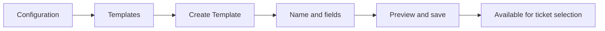
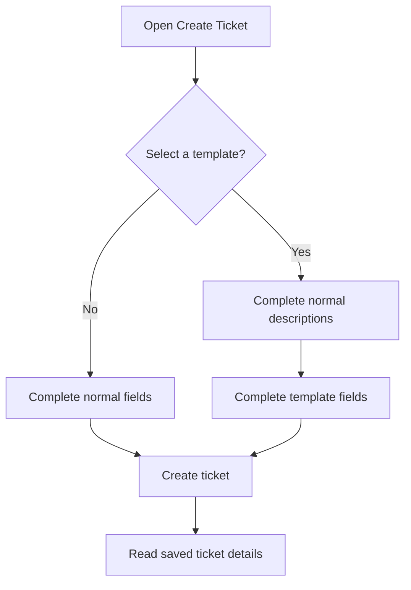

# Ticket Templates: Configure Once, Use on Relevant Tickets

Templates add customer-specific or process-specific fields to the normal ticket form. Selection is optional. Short Description and Full Description remain part of the ticket.

## Example Templates for Three Customers

| Template name | Example purpose | Example additional fields |
| --- | --- | --- |
| Delloitte | Investigation context | Investigation Notes, Affected Users, Environment, Customer Approval Received |
| Wipro | Service request details | Request Details, Requested Quantity, Request Type |
| Accenture | Change coordination | Change Summary, Planned Window, Validation Complete |

These are sample designs, not templates automatically created by this article. Choose fields that match your customer's needs.

## Delloitte: A Complete Field Design

| Field name | Field type | Example value | Suggested required? |
| --- | --- | --- | :---: |
| Investigation Notes | Text, long or short | Two browsers tested; timeout and start time recorded | Yes |
| Affected Users | Integer, whole number | 25 | Yes |
| Environment | Dropdown | Production | Yes |
| Customer Approval Received | Toggle, On / Off | On | No |

Configure Environment options as **Production**, **Test** and **Development**, one option per line.

## Create the Template

1. Open **Configuration > Templates > Create Template**.
2. Enter **Delloitte** in Template Name.
3. Click **Create New Field**.
4. Enter the field name, choose its type and add dropdown options if needed.
5. Check **Required field** when an answer is needed for tickets using this template.
6. Repeat for the remaining fields.
7. Use up and down controls to arrange display order. Remove unnecessary fields.
8. Review the preview and save.

A template needs a name and at least one field. Field names must be unique within that template. Dropdown options must be non-empty and unique.

## Choose a Field Type

| Type | Best for | Input rule | What the reader sees |
| --- | --- | --- | --- |
| Text | Brief answers or detailed investigations | Text content | Multiline area with scrolling for long content |
| Integer | Counts and whole-number values | Whole numbers; zero is valid | Saved number |
| Dropdown | One controlled choice | Must match a configured option | Selected option |
| Toggle | A yes-or-no setting | On or Off; Off is valid | Saved toggle value |

Required template fields apply only when that template is selected. They do not make the Templates dropdown mandatory.

## Create a Ticket: Worked Example

| Ticket section | Example entry |
| --- | --- |
| Templates, below ticket-number heading | Delloitte |
| Short Description | Production inventory sign-in timeout affects 25 users |
| Full Description | At the recorded start time, warehouse users began receiving Authentication timeout; dispatch preparation is delayed |
| Investigation Notes | Compared two browsers, checked affected users and attached an approved screenshot |
| Affected Users | 25 |
| Environment | Production |
| Customer Approval Received | On |

Complete normal incident details and descriptions. The extra fields appear **after Short Description and Full Description**. Save after all required values are complete.

## What Happens After Saving?

| Situation | Application behavior |
| --- | --- |
| Ticket has a template | Name appears beneath the ticket number |
| Ticket has no template | No template placeholder text is shown beneath the number |
| Reader opens the ticket | Saved template answers appear below the descriptions |
| Text answer is lengthy | Scroll inside the text area to read the full answer |
| Administrator edits the template | Existing tickets retain their saved definition |
| Template deactivated | Unavailable for new selections; existing tickets retain information |
| Authorized user clears selection and saves | Template information is removed from that ticket |

The ticket saves a snapshot of the template name and fields, plus answers. This preserves historical layout when configuration changes.

## Permissions and Troubleshooting

| Need | Permission or setting to check |
| --- | --- |
| Open configuration | View template configuration |
| Create a template | Create templates |
| Change fields or order | Edit template fields and order |
| Change availability | Activate or deactivate templates |
| Select or change a ticket template | Select or change template within allowed ticket scope |
| Edit saved answers | Applicable ticket editing permission and scope |

| Problem | Example cause | What to do |
| --- | --- | --- |
| Template missing | Inactive or not saved | Check configuration and selection permission |
| Number rejected | Entered 2.5 in Integer | Enter a whole number |
| Save blocked | Required answer empty | Complete the field named in the message |
| Old ticket has older fields | Historical snapshot preserved | Read the ticket's saved definition |
| Template changed accidentally | A different field set may replace the current one on save | Review answers before switching or clearing |

Use Templates for information that varies by customer or workflow, and normal descriptions for the core explanation of the issue.
