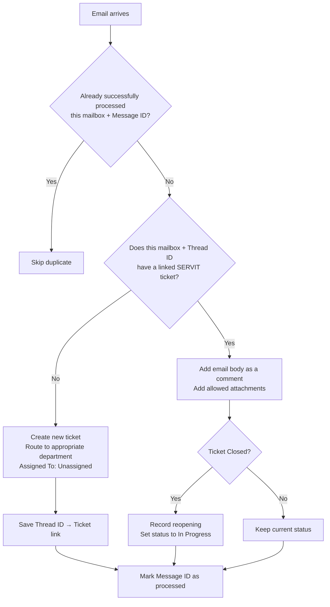

**Yes, this is a reasonable approach for the first version.** Using Gmail’s **Message ID and Thread ID** makes the behaviour simpler and easier to test.

The rule would be:

- **Message ID** checks whether we already processed that individual email.
- **Thread ID** finds the SERVIT ticket for that conversation.
- Include the **connected mailbox** in both checks, so different mailboxes remain separate.

We can still save the customer’s case number for reference, but **we would not use it to match tickets**.

**The simplified flow**
````rust

````

**Example 1 — First email creates a ticket**

Dell sends:

> Storage is slow. Our case number is DELL-4587.
```
Mailbox:    support@servit.example
Message ID: MSG-001
Thread ID:  THREAD-100
```

Neither identifier is known. SERVIT creates **INC000025**, routes it to the appropriate department and leaves it unassigned.

It saves:
```
THREAD-100 → INC000025
MSG-001    → Successfully processed
```

**Example 2 — Dell replies to the same conversation**

Dell clicks Reply:

> The issue is still happening. Logs attached.
```yaml
Message ID: MSG-002       ← Different email
Thread ID:  THREAD-100    ← Same conversation
```

SERVIT finds **THREAD-100 → INC000025**.

It adds the email as a comment and saves the attachments. **No new ticket is created**, even though Dell did not repeat its case number.

**Example 3 — The same email is delivered twice**

SERVIT receives **MSG-002** again.

It finds that MSG-002 was successfully processed, so it skips it. There is **no duplicate comment or ticket**.

**Example 4 — Dell replies after closure**

INC000025 is Closed and assigned to Saranya. Dell replies in THREAD-100:

> The issue has returned.

SERVIT:

- Updates **INC000025**.
- Adds the email as a comment.
- Records a reopening.
- Sets the status to **In Progress**.
- Keeps Saranya as the assignee.

**Example 5 — Dell starts a new conversation with the same case number**

Dell clicks Compose and sends:

> Please update us about DELL-4587.
```yaml
Message ID: MSG-003
Thread ID:  THREAD-200    ← New conversation
```

THREAD-200 is unknown, so SERVIT creates **INC000026**.

**This happens even though DELL-4587 already exists on INC000025**, because case numbers are no longer used for matching.

**Example 6 — A different issue is sent as a reply**

Dell replies in THREAD-100:

> We also have a separate problem with another storage system.

Because the thread is still THREAD-100, SERVIT adds it to **INC000025**.

It will not automatically recognise that this should be a separate issue. A person would need to separate it manually.

**The trade-off is clear**

| Customer action                        | SERVIT behaviour        |
| -------------------------------------- | ----------------------- |
| Replies within the same Gmail thread   | Updates the same ticket |
| Starts a new Gmail thread              | Creates a new ticket    |
| Sends a new issue inside an old thread | Updates the old ticket  |
| Same message is delivered again        | Skips the duplicate     |

**My recommendation: proceed with this simpler design**, provided your manager accepts the two limitations above. Tell customers and your support team to **continue the same conversation for the same issue and start a new conversation for a new issue**.

We should still handle failed processing safely: mark an email as processed only after its work succeeds, and make retries reuse any ticket or comment already saved. No acknowledgement email would be sent.
